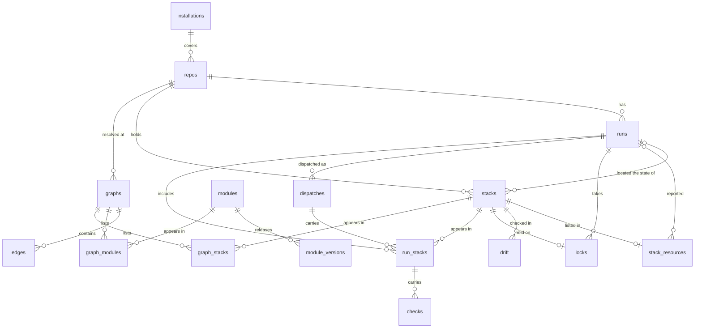

# Data model

Postgres is the server's only stateful dependency. It holds the graphs, the run history, the locks, the audit log and the work queue. Nothing in it is needed to operate Terraform, except by stacks that read [shared outputs](/configuration/outputs): wiping the database loses history and locks, never state. It also loses where each stack's state lives, so shared outputs answer `state_location_unknown` for a stack until its next apply or drift job, and the plans of the stacks that read its outputs fail until then. Each stack's resource list is gone too until its next apply or drift job reports it again.

All timestamps are UTC `timestamptz`. Stackorder's own ids (`runs.id`, `stacks.id`, `modules.id`, `graphs.id`, `dispatches.id`) are UUIDs; `installations.id` and `repos.id` are GitHub's numeric ids. The schema is created by the migrations in `migrations/`, `0001_graph` to `0016_api_key_scopes`. `repos` and `graphs` reference each other (`repos.default_graph_id` → `graphs`, `graphs.repo_id` → `repos`), and `repos.default_graph_id` is `DEFERRABLE INITIALLY DEFERRED` so a data-only dump of both tables restores in a single transaction; see [Upgrades and backups](/operations/upgrades-and-backups#data-only).

## Tables {#tables}

### Graph {#graph-tables}

| Table | Key columns | Notes |
| --- | --- | --- |
| `installations` | `id`, `account`, `account_type`, `suspended_at`, `suspend_observed_at` | One per GitHub App installation. `suspend_observed_at` is the observation time of the last `suspend`/`unsuspend` applied — a webhook delivery's `received_at`, or the database time the daily sync read before listing — so an `installation` event observed earlier but processed later is ignored and the suspension follows the most recently observed one |
| `repos` | `id`, `installation_id`, `full_name` (unique), `default_branch`, `config` (jsonb), `config_sha`, `private`, `default_graph_id` | `config` is the parsed `stackorder.yaml` of the default branch at `config_sha`; `default_graph_id` is the graph of the last merged pull request |
| `graphs` | `id`, `repo_id`, `sha`, `tree_hash`, `warnings`, `external_stacks`, `created_at` | One row per repository and commit (`UNIQUE (repo_id, sha)`); `tree_hash` enables cache hits |
| `stacks` | `id`, `repo_id`, `key`, `path`, `workspace`, `backend` (jsonb), `environment`, `tool`, `config` (jsonb), `state_object` (jsonb), `state_object_run_id`, `state_object_at`, `first_seen_at`, `last_seen_at`, `removed_at` | Stable identity per repository and key (`UNIQUE (repo_id, key)`), so history survives commits. `key` is `path` or `path:instance`, so each [instance](/configuration/instances) of a directory has its own row, and the instance is split off the key rather than stored in a column; `workspace` is the Terraform workspace the CLI selects, empty for none. `backend` holds the effective S3 bucket, key, region and lock settings, after `backend_config`. `state_object` is the bucket, key and region where the newest apply or drift job that reported one found the stack's state, with that job's run and the time it was recorded; [shared outputs](/configuration/outputs#state-location) read the state from there. With shared outputs on, the object must lie under an entry of `STACKORDER_STATE_BUCKETS` granted to the stack's repository: a report of any other object leaves `state_object` null, with that job's run and time. Saving a graph rewrites `backend` and `config` but never `state_object`. `first_seen_at` and `last_seen_at` bound when a graph last carried the stack. `removed_at` is set when the repository's default-branch graph (`repos.default_graph_id`) no longer lists the stack and cleared when it lists it again, so the stack lists and [`/v1/overview`](/reference/api#overview) leave removed stacks out while their history, runs and last resource list stay; a stack reached directly by id is still served |
| `graph_stacks` | `graph_id`, `stack_id`, `node` (jsonb) | Which stacks a graph has, with the stack node as scanned, including its `instance` and `watch_paths` |
| `modules` | `id`, `source_key` (unique), `base_key`, `kind` (`local`, `git`, `registry`), `source`, `path`, `ref` | One row per pinned module (`key@ref`) and one ref-less family row per `base_key`, which versions attach to |
| `graph_modules` | `graph_id`, `module_id`, `node` (jsonb) | Which modules a graph has |
| `edges` | `graph_id`, `from_kind`, `from_key`, `to_kind`, `to_key`, `type`, `inferred`, `meta` (jsonb) | Keys rather than ids, so an edge can point at a stack in another repository; `meta` holds `ref` and `source` for module edges, `bucket` and `key` for a `reads_state` edge inferred from `terraform_remote_state`, and `source` `stackorder_outputs` for one inferred from a `stackorder_outputs` block |
| `module_versions` | `module_id`, `version`, `sha`, `tagged_at` | Semver tags pushed to module repositories |

### Runs {#run-tables}

| Table | Key columns | Notes |
| --- | --- | --- |
| `runs` | `id`, `repo_id`, `sha`, `base_sha`, `pr_number`, `trigger`, `mode`, `status`, `requested_by`, `graph_id`, `waves`, `current_wave`, `warnings`, `workflow_run_id`, `workflow_run_attempt`, `check_runs` (jsonb), `comment_id`, `created_at`, `started_at`, `finished_at` | `trigger` is `pull_request`, `comment`, `push`, `schedule`, `rerequest` or `manual`; `check_runs` records the GitHub check run ids the server created; `comment_id` is the GitHub id of the pull request comment that tracks an apply run, `NULL` until the server looks it up and a positive id once posted; it is `0` only for a terminal run that has no such comment and gets none, and a run still in progress whose comment was deleted or belongs to a replaced App is given a new one |
| `run_stacks` | `run_id`, `stack_id`, `wave`, `mode`, `status`, `reasons`, `via`, `environment`, `adds`, `changes`, `destroys`, `replaces`, `has_changes`, `exit_code`, `job_url`, `plan_artifact`, `plan_run_id`, `summary` (jsonb), `plan_text`, `plan_text_truncated`, `plan_url`, `plan_output`, `error_text`, `blocked_by`, `dispatch_id`, `started_at`, `finished_at`, `updated_at` | One row per stack per run; the observability core. `via` lists the modules or stacks the change reached the stack through, as the graph replay shows it. `plan_text` is capped at 256 KB, or 8 KB with the artifact bucket |
| `checks` | `run_id`, `stack_id`, `name`, `status`, `summary`, `details`, `details_url`, `updated_at` | Named check verdicts, one per stack, run and name |
| `dispatches` | `id`, `run_id`, `wave`, `environment`, `mode`, `chunk`, `workflow_run_id`, `dispatched_at`, `sent_at`, `completed_at`, `conclusion` | One row per `workflow_dispatch`, unique per (run, wave, environment, mode, chunk); a workflow run id belongs to at most one dispatch |
| `locks` | `stack_id`, `run_id`, `pr_number`, `taken_at`, `reason` | Primary key on `stack_id`, so a lock is unique by construction |
| `drift` | `id`, `stack_id`, `run_id`, `checked_at`, `drifted`, `summary` (jsonb), `issue_number` | One row per drift check; the latest per stack is what the UI shows |
| `stack_resources` | `stack_id`, `run_id`, `run_mode`, `sha`, `observed_at`, `reported_at`, `changed_at`, `total`, `truncated`, `digest`, `resources` (jsonb) | One row per stack (primary key `stack_id`): the [resource list](/guide/concepts#resources) the stack's apply or drift job last reported from its state, each managed resource's address, type, module, provider and tainted and deposed flags, never an attribute value. `run_id` names that job's run and becomes `NULL` if the run is deleted. A list replaces the recorded one only when its `observed_at` is not older: the time a confirmed apply result first arrives, its `run_stacks.finished_at` when the same result arrives again, otherwise its run's `created_at`. `digest` is the SHA-256 of the list, and `changed_at` moves only when it differs. The last change of each resource is not stored: the server derives it from the `summary` of the stack's applied `run_stacks` rows, read through the partial index `run_stacks_applied_idx` |

### Queue and access {#queue-tables}

| Table | Key columns | Notes |
| --- | --- | --- |
| `events` | `id` (the delivery id), `kind`, `payload`, `received_at`, `claimed_by`, `claimed_at`, `attempts`, `run_after`, `done_at`, `last_error`, `trace_context` | Webhook deliveries; the delivery id as primary key deduplicates redeliveries |
| `jobs` | `id`, `kind`, `payload`, `dedupe_key` (unique), `run_after`, `claimed_by`, `claimed_at`, `attempts`, `done_at`, `last_error`, `created_at`, `trace_context` | Scheduled and internal work |
| `object_deletions` | `run_id`, `stack_key`, `enqueued_at`, `attempts`, `last_error` | Plan objects (`plan.txt` and `plan.json`) waiting to be removed from the [artifact bucket](/reference/server-configuration#artifact-bucket) after pruning plan text or removing a repository (migration 0012). No foreign key, so a row outlives the run it names; the prune job sweeps it and the [`stackorder_pending_object_deletions`](/reference/metrics) gauge counts it |
| `oidc_jtis` | `jti`, `expires_at` | Runner token ids already accepted, so a token is used once |
| `sessions` | `id`, `login`, `user_id`, `avatar_url`, `orgs`, `created_at`, `expires_at` | `id` is the SHA-256 of the session token |
| `api_keys` | `id`, `name`, `key_hash` (unique), `prefix`, `created_by`, `created_at`, `last_used_at`, `revoked_at`, `read_only`, `installation_id`, `expires_at` | `key_hash` is the SHA-256 of the key, `prefix` its first 10 characters; `read_only` (default false), `installation_id` (null = every installation) and `expires_at` (null = never) scope the key |
| `audit` | `id`, `at`, `actor`, `action`, `target`, `details` (jsonb) | Unlocks, re-runs, manual applies, commands, reads of a stack's outputs (`outputs_read`, `outputs_refused`, with counts and never values) and other audited actions |

`trace_context` (added in migration 0015) holds the [W3C trace context](/reference/metrics#tracing) of the request or job that queued the row, as a JSON object, so the worker span continues that trace; it is `NULL` when tracing is off and on rows queued before the upgrade.

`golang-migrate` adds its own `schema_migrations` table.

Edges point at stacks and modules by kind and key, so they are not drawn as foreign keys above.

## The queue {#queue}

`events` and `jobs` replace a message queue. Webhooks are written to `events` and acknowledged at once. Workers claim rows with `SELECT ... FOR UPDATE SKIP LOCKED`, and every handler is idempotent, so the work of a crashed instance is simply claimed again: a claim older than 10 minutes is released, and a handler runs at most 5 minutes. `attempts` and `run_after` drive retries after 1 min, 5 min, 30 min and 2 h; after 5 attempts a row is a dead letter. A job's `dedupe_key` stays taken until the job is pruned, so recurring jobs put a time slot in their key.

Rows are claimed oldest-due first with no ordering per installation, so several workers and replicas can process the events of one installation at once or out of receive order, and a failed event is retried after later ones have run. Handlers are idempotent, and the order-sensitive one, the installation `suspend` and `unsuspend`, resolves the ordering itself: it stamps `installations.suspend_observed_at` with the delivery's `received_at` and takes effect only when that time is no earlier than the last applied, as a single compare-and-set, so the suspension converges on the most recently observed delivery whatever order the workers ran. A `suspend` seen before the installation's `created` records the installation itself, so a later `created` with an earlier receive time does not revive it. The daily installation sync records each suspension with the database time it read before listing, so a delivery received after the listing still wins over it. The compare-and-set binds writers on the same version; a replica still on v0.5.0 during a [rolling upgrade](/operations/upgrades-and-backups#server) writes last-processed-wins, which the sync reconciles.

## Size {#size}

A 300-stack monorepo with 2,000 edges is well under a megabyte per graph. The resolve job sends a tree hash of the paths it scanned, so a re-run on the same tree is a cache hit and stores nothing new.

Plan text is cut at 256 KB by the CLI. With `STACKORDER_ARTIFACT_BUCKET` set, the full text goes to that bucket and Postgres keeps its first 8 KB; see [Artifact bucket](/reference/server-configuration#artifact-bucket).

## Retention {#retention}

An hourly `prune` job applies the retention settings:

| Data | Kept | Setting |
| --- | --- | --- |
| Plan text in `run_stacks` | 30 days after the row last changed; the summary stays. With an [artifact bucket](/reference/server-configuration#artifact-bucket), `plan_url` is cleared and the stack's `plan.txt` and `plan.json` objects are queued in `object_deletions` and deleted by the same prune job. A row an older server left with a `plan_url` after clearing only its plan text is reclaimed the same way (migration 0013 indexes those rows), so an upgrade or a mixed-version prune cannot strand its objects | `STACKORDER_PLAN_TEXT_RETENTION`, default `720h` |
| Webhook events | 7 days after they were received, once done or never claimed | `STACKORDER_EVENT_RETENTION`, default `168h` |
| Finished jobs | 7 days after they finished | `STACKORDER_EVENT_RETENTION` |
| Drift history | 90 days, always keeping the latest result of each stack | `STACKORDER_DRIFT_RETENTION`, default `2160h` |
| Accepted runner token ids | Until the token expires | |
| Sessions | Until they expire, 7 days after sign-in | |
| Locks | Until released | |
| Resource list of a stack | Until a newer list replaces it, or the stack's repository is deleted; it outlives its run | |
| Runs, stack rows, summaries, checks, graphs, API keys, audit log | Indefinitely | |

## Migrations {#migrations}

Migrations are `golang-migrate` SQL files, `NNNN_name.up.sql` and `NNNN_name.down.sql`, embedded in the binary. The server runs the up files at start-up under a Postgres advisory lock, so several instances starting together apply each migration once, and it refuses to start if a migration fails or the schema is at a version it does not embed. It never runs the down files itself; every migration has one, and an operator rolling back to an older release runs them explicitly with [`stackorder-server migrate --down`](/reference/server-configuration#migrate). See [Upgrades and backups](/operations/upgrades-and-backups).
