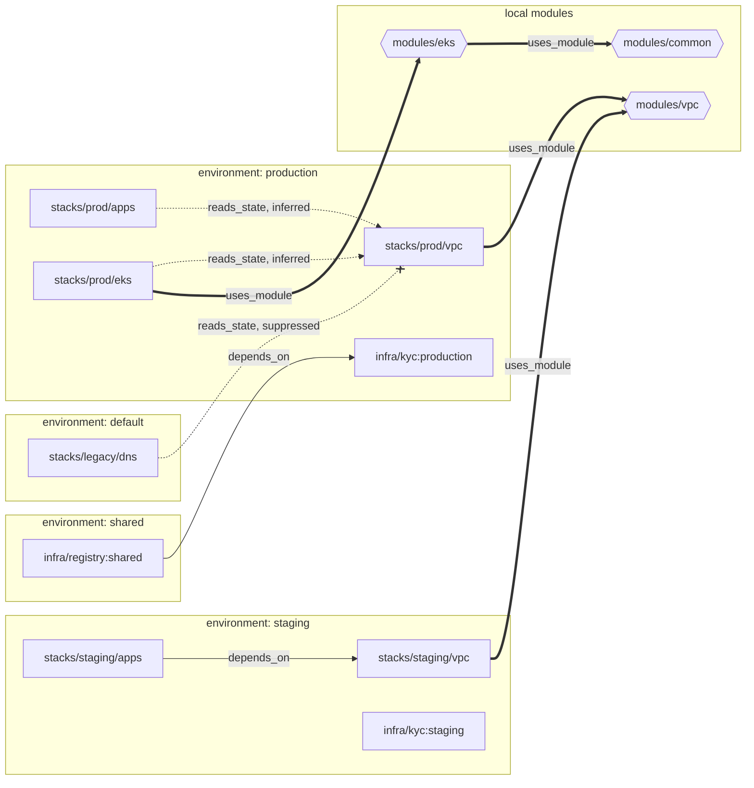

<p align="center">
  <a href="https://stackorder.io">
    <picture>
      <source media="(prefers-color-scheme: dark)" srcset=".github/assets/lockup-dark.svg">
      
    </picture>
  </a>
</p>

<p align="center">Lightweight Terraform and OpenTofu orchestration on GitHub Actions.</p>

<p align="center">
  <a href="https://stackorder.io">Website</a> ·
  <a href="https://docs.stackorder.io">Documentation</a> ·
  <a href="https://github.com/stackorder/stackorder">stackorder/stackorder</a>
</p>

# Stackorder example infrastructure

A small Terraform monorepo wired for [Stackorder](https://github.com/stackorder/stackorder). Its dependency graph has two local modules consumed by stacks, a module that calls another module, explicit `depends_on` edges, an inferred `terraform_remote_state` edge, a suppressed one, an edge inferred from a stack that reads another stack's outputs through the Stackorder server, a stack that falls back to the `default` environment, and a directory deployed once per environment as [stack instances](#stack-instances).

It serves two purposes. The Stackorder end-to-end tests run the real CLI, server and Terraform against it, and it is the example to read when you want to see how a repository is wired for Stackorder.

This repository runs against no live infrastructure. It has no Stackorder server, AWS account or GitHub environments behind it. `stackorder-plan.yml` and `stackorder-run.yml` are wiring to copy: their jobs skip themselves here through `if: github.repository != 'stackorder/example-infra'` and run unchanged in a copy. The stacks are exercised only by the [end-to-end suite](#how-the-end-to-end-tests-use-this-repository) in `stackorder/stackorder`, against LocalStack, an in-process server and a fake GitHub.

Nothing here creates cloud resources. Every resource is a `terraform_data`, and the only provider is `stackorder/stackorder`, which `stacks/prod/eks` uses to read the outputs of `stacks/prod/vpc`, so `init` downloads that one provider for that stack and nothing elsewhere. A plan also talks to the S3 state bucket and to STS, which the S3 backend and `terraform_remote_state` call to validate credentials, and a plan of `stacks/prod/eks` needs a Stackorder server that serves the VPC outputs. The end-to-end suite provides all three, with LocalStack for S3 and STS. VPC, subnet and cluster ids are fake values derived from names, so they are the same on every apply.

## Tested versions

This repository was tested with:

| Component | Version |
| --- | --- |
| [`stackorder/stackorder`](https://github.com/stackorder/stackorder) (server and CLI) | v0.4.0 |
| [`stackorder/terraform-provider-stackorder`](https://github.com/stackorder/terraform-provider-stackorder) (provider `stackorder/stackorder` on the Terraform and OpenTofu registries) | v0.1.0 |
| [`stackorder/actions`](https://github.com/stackorder/actions) (`plan.yml`, `run.yml`) | v1.0.0, called as `@v1` |
| Terraform | 1.14.4 |
| OpenTofu | 1.12.6 |
| LocalStack (S3 and STS, for the end-to-end tests) | 4.0 |

The stacks need Terraform or OpenTofu 1.10 or later for `use_lockfile`, and the `infra/` stacks need Terraform 1.10 or OpenTofu 1.11 or later for their `ephemeral` variable. `validate.yml` pins the same Terraform and OpenTofu versions, and the Stackorder end-to-end suite runs against this repository with both tools. No `.terraform.lock.hcl` is committed, because Terraform records the provider under `registry.terraform.io` and OpenTofu under `registry.opentofu.org`, and each tool drops the other's entry when it initialises, so one lock file cannot serve both.

## Layout

```text
stackorder.yaml                 repository policy: discovery, environments, apply gate, drift
.github/CODEOWNERS              owning teams per path
.github/assets/                 README logos and the repository social preview image
.github/workflows/
  stackorder-plan.yml           PR plans through stackorder/actions plan.yml; skipped in this repository
  stackorder-run.yml            server-dispatched plan, apply and drift through run.yml; skipped in this repository
  validate.yml                  fmt check, validate and test for Terraform and OpenTofu; no backend
.stackorder/hooks/post-plan.sh  example hook: resource count from the plan JSON
modules/
  common/                       tagging helper (locals and outputs only)
  vpc/                          fake VPC and three subnets; tests/ pins the prod ids and the staging id stacks/staging/apps relies on
  eks/                          fake cluster; tags through ../common; tests/ checks tags and inputs
stacks/
  prod/vpc/                     modules/vpc, state prod/vpc.tfstate, outputs.readers: stacks/prod/eks
  prod/eks/                     modules/eks, reads the stacks/prod/vpc outputs with stackorder_outputs
  prod/apps/                    reads prod/vpc.tfstate with terraform_remote_state
  staging/vpc/                  modules/vpc, state staging/vpc.tfstate
  staging/apps/                 depends_on stacks/staging/vpc, plan_output: summary
  legacy/dns/                   reads prod/vpc.tfstate, edge suppressed with ignore_inferred
infra/
  state.s3.tfbackend            shared partial backend config: bucket, region, use_lockfile
  kyc/                          partial S3 backend; one instance per workspaces/*.tfvars.json
    workspaces/                 production.tfvars.json, staging.tfvars.json
  registry/                     one declared instance, shared; depends_on infra/kyc:production
Makefile                        fmt, validate, test, graph
```

Every stack has an S3 backend in bucket `stackorder-example-state`, region `us-east-1`, with `use_lockfile = true` (S3-native locking, which is why stacks require Terraform or OpenTofu 1.10 or later). The state key is the stack path without the `stacks/` prefix, for example `prod/vpc.tfstate`. The `infra/` stacks use the same bucket through a partial backend; their keys are rendered per instance (see [Stack instances](#stack-instances)).

## The dependency graph



Arrows point from the dependent to what it depends on, as in the Stackorder API and `stackorder graph` output.

| Arrow | Edge | Declared by | Orders applies | Propagates changes |
| --- | --- | --- | --- | --- |
| Solid | `depends_on` | `depends_on` in the stack's `.stackorder.yaml` | Yes | Yes |
| Thick | `uses_module` | A `module` block with a relative `source`, followed through nested modules | No | Yes |
| Dotted | `reads_state` | Inferred: a `terraform_remote_state` whose S3 bucket and key match another stack's backend, or a `stackorder_outputs` block whose literal `stack` names another stack | Yes | Yes |
| Dotted, crossed | suppressed `reads_state` | `ignore_inferred` in the reading stack's `.stackorder.yaml` | No | No |

Things worth noticing:

- `stacks/prod/apps` has no `.stackorder.yaml`. Its edge to `stacks/prod/vpc` exists only because its `terraform_remote_state` block names `prod/vpc.tfstate` in `stackorder-example-state`, which is that stack's backend.
- `stacks/prod/eks` has no `.stackorder.yaml` either. Its `stackorder_outputs` data source names `stacks/prod/vpc` as a literal `stack`, so the scan infers a `reads_state` edge (`source: stackorder_outputs` in `stackorder graph --format json`), and its plan reads the VPC id and subnets through the Stackorder server, without access to the VPC state.
- `stacks/prod/vpc` lists `stacks/prod/eks` under `outputs.readers` in its `.stackorder.yaml`. The server reads that list from the default branch only, so a pull request cannot widen it. The VPC outputs are not sensitive, so `outputs.sensitive` keeps its default, `withhold`.
- `stacks/legacy/dns` reads the same state as `stacks/prod/apps`, but lists `stacks/prod/vpc` under `ignore_inferred`, so the edge is dropped and the scan reports a warning saying so.
- `modules/eks` calls `../common`, so a change to `modules/common` reaches `stacks/prod/eks` through two `uses_module` edges.
- `stacks/legacy/` matches no prefix in `environments`, so that stack runs under the GitHub environment `default`.
- `infra/kyc:production` and `infra/kyc:staging` are two stacks from one directory. Neither `environments` prefix matches `infra/`, so each runs under the GitHub environment of its own instance name, which happens to match the `production` and `staging` environments of the `stacks/` stacks.
- `infra/registry:shared` depends on one instance only. A change to `infra/kyc` still reaches it, because a change to a directory affects every instance of that directory.

## What a change affects

Waves are numbered from 0. A wave starts only when the previous one has finished, and the server dispatches `stackorder-run.yml` once per wave and environment. Reasons are the `reasons` values of the resolve response.

### Change `modules/vpc`

| Wave | Stack | Environment | Reason |
| --- | --- | --- | --- |
| 0 | `stacks/prod/vpc` | production | `module`: uses `modules/vpc` |
| 0 | `stacks/staging/vpc` | staging | `module`: uses `modules/vpc` |
| 1 | `stacks/prod/apps` | production | `reads_state`: reads `stacks/prod/vpc` (inferred) |
| 1 | `stacks/prod/eks` | production | `reads_state`: reads `stacks/prod/vpc` (inferred) |
| 1 | `stacks/staging/apps` | staging | `dependent`: depends on `stacks/staging/vpc` |

`stacks/legacy/dns` is not affected because its edge is suppressed. `modules/eks` and `modules/common` are in the graph but not touched. An apply is four dispatches: wave 0 for production and for staging, then wave 1 for production and for staging.

### Change `stacks/prod/eks` only

| Wave | Stack | Environment | Reason |
| --- | --- | --- | --- |
| 0 | `stacks/prod/eks` | production | `changed` |

Nothing depends on `stacks/prod/eks`. `stacks/prod/vpc` is one of its dependencies, not a dependent, so it is not planned.

### Change `modules/eks`

| Wave | Stack | Environment | Reason |
| --- | --- | --- | --- |
| 0 | `stacks/prod/eks` | production | `module`: uses `modules/eks` |

A change to `modules/common` gives the same result, through `modules/eks`.

### Change `infra/kyc`

A change anywhere under `infra/kyc`, including one of its var files, affects every instance of the directory.

| Wave | Stack | Environment | Reason |
| --- | --- | --- | --- |
| 0 | `infra/kyc:production` | production | `changed` |
| 0 | `infra/kyc:staging` | staging | `changed` |
| 1 | `infra/registry:shared` | shared | `dependent`: depends on `infra/kyc:production` |

The two instances share a directory but nothing else: each has its own lock, plan artifact (`stackorder-plan-infra-kyc-production-<hash>-<sha>` and `stackorder-plan-infra-kyc-staging-<hash>-<sha>`), check run and state object. An apply is three dispatches: wave 0 for production and for staging, then wave 1 for shared. None of the `stacks/` stacks is affected.

### Change `infra/state.s3.tfbackend`

| Wave | Stack | Environment | Reason |
| --- | --- | --- | --- |
| 0 | `infra/kyc:production` | production | `watch_path`: reads `infra/state.s3.tfbackend` |
| 0 | `infra/kyc:staging` | staging | `watch_path`: reads `infra/state.s3.tfbackend` |
| 1 | `infra/registry:shared` | shared | `watch_path`: reads `infra/state.s3.tfbackend`; `dependent`: depends on `infra/kyc:production` |

The file lies outside every stack directory, so it belongs to no stack; it affects the stacks that list it in `backend_config`. `infra/registry:shared` is affected directly but still applies in wave 1, after `infra/kyc:production`, because waves follow `depends_on` edges.

### Docs-only change

| Wave | Stack | Environment | Reason |
| --- | --- | --- | --- |
| | none | | |

Editing `README.md`, a stack's `README.md` or any other Markdown file affects nothing. `stackorder.yaml` does not set `stacks.ignore`, so it gets the default `["**/*.md", "**/README*"]`. The plan matrix is empty and no plan job runs.

## Stack instances

`infra/` mirrors a monorepo where one directory is deployed once per environment: a partial S3 backend, one backend config file shared by every component, and a var file per environment. Stackorder turns each deployment into a stack of its own, keyed `path:instance`.

| Stack | Instance from | Var files | State key | GitHub environment |
| --- | --- | --- | --- | --- |
| `infra/kyc:production` | `workspaces/production.tfvars.json` | `workspaces/production.tfvars.json` | `kyc/production.tfstate` | `production` |
| `infra/kyc:staging` | `workspaces/staging.tfvars.json` | `workspaces/staging.tfvars.json` | `kyc/staging.tfstate` | `staging` |
| `infra/registry:shared` | `instances: [shared]` | none | `registry/shared.tfstate` | `shared` |

The configuration keys it exercises:

- `stacks.instances.from_var_files: "workspaces/*.tfvars.json"` in `stackorder.yaml` names one instance per matched file, after the file's base name up to its first `.`, and passes that file to `plan` as `-var-file`. The `stacks/` stacks have no `workspaces/` directory, so they keep their suffix-less keys.
- `instances: [shared]` in `infra/registry/.stackorder.yaml` declares the instance set outright and takes precedence over `from_var_files`.
- `backend_config` in each `infra/` stack's `.stackorder.yaml` lists `infra/state.s3.tfbackend` (a file, relative to the repository root) and `key={{ trimPrefix "infra/" .Path }}/{{ .Instance }}.tfstate` (a rendered `name=value`). The CLI passes both to `init` as `-backend-config`, with `-reconfigure`, so two instances can share one checkout. It sits in the stack files rather than in `stackorder.yaml` because a root `backend_config` overlays the backend of every discovered stack, exactly like passing `-backend-config` to every `init`: here its `key` would replace the literal keys of the `stacks/` backends. Put it at the root only when every discovered stack takes its backend from it.
- `env` in `stackorder.yaml` sets `TF_VAR_environment` to the instance name and `TF_VAR_role` to `plan` for plan and drift and `deploy` for apply. The `stacks/` stacks declare neither variable, so Terraform ignores both there.
- `depends_on: ["infra/kyc:production"]` names one instance of another directory.
- The GitHub environment of an instance is its own name unless something maps it elsewhere; `environments` has no `infra/` key, so the instance names apply as they are.

`role` is `ephemeral`. Terraform freezes the values of ordinary variables in a saved plan, but asks for ephemeral ones again when it applies that plan, so the apply runs with `TF_VAR_role=deploy` although the plan was made with `plan`. Its validation accepts only those two values, and a precondition on the `terraform_data` requires `deploy` while `terraform.applying` is true, so an apply that got the plan value fails before anything is created. A real stack would pass the variable to a provider's `assume_role` to choose a read-only or a deploy role.

`infra/registry` validates that `environment` is `shared`, so its plan fails if `TF_VAR_environment` renders anything other than its instance name.

## How the end-to-end tests use this repository

The e2e suite in `stackorder/stackorder` (`test/e2e`, build tag `e2e`) runs the server in process, the `stackorder` CLI and real Terraform against a checkout of this repository, with LocalStack standing in for AWS and a fake GitHub standing in for GitHub. It creates the bucket `stackorder-example-state` in `us-east-1` before the first `init`.

The tests start the server with `STACKORDER_STATE_BUCKETS` set to an entry that grants the repository under test that bucket, such as `acme/example-infra=stackorder-example-state`, and with its own `AWS_ENDPOINT_URL_S3` pointing at the emulator. The `stackorder/stackorder` provider of `stacks/prod/eks` never touches the bucket: it asks the server for the outputs of `stacks/prod/vpc`, and the server reads `prod/vpc.tfstate` and returns only its outputs.

The backend and the `terraform_remote_state` reads are configured as they would be for AWS; nothing in the HCL points at the emulator. The tests redirect them from the environment:

| Variable | Example value | Used by |
| --- | --- | --- |
| `AWS_ACCESS_KEY_ID`, `AWS_SECRET_ACCESS_KEY` | `test`, `test` | Backend and remote state reads |
| `AWS_REGION` | `us-east-1` | Backend and remote state reads |
| `AWS_ENDPOINT_URL_S3` | `http://s3.localhost.localstack.cloud:4566` | Backend and remote state reads |
| `AWS_ENDPOINT_URL_STS` | `http://localhost:4566` | Remote state reads, which call `sts:GetCallerIdentity` |
| `STACKORDER_BACKEND_CONFIG` | `use_path_style=true,skip_credentials_validation=true,skip_requesting_account_id=true` | Backend only; the CLI passes each item to `init` as `-backend-config` |

Four details matter:

- `STACKORDER_BACKEND_CONFIG` reaches the backend but not the `config` block of a `terraform_remote_state`. The remote state reads therefore validate credentials against STS, so the emulator must serve STS as well as S3 (for LocalStack, `SERVICES=s3,sts`).
- Without `use_path_style`, the remote state reads use virtual-hosted addressing (`http://stackorder-example-state.<endpoint host>/prod/vpc.tfstate`). LocalStack recognises that form under `s3.localhost.localstack.cloud`, whose public DNS resolves to 127.0.0.1. Emulators that take the bucket from the first label of the host, such as moto, also work with `http://localhost:<port>`, wherever `*.localhost` resolves to loopback.
- `stacks/prod/apps` and `stacks/legacy/dns` fail to plan with `Unable to find remote state` until `prod/vpc.tfstate` exists. The tests apply `stacks/prod/vpc` (or upload a state object at that key) before they plan either stack.
- `stacks/prod/eks` fails to plan until `stacks/prod/vpc` has been applied through Stackorder. The server records where a stack's state lives only from the result of an apply or drift job, so an uploaded state object is not enough, and until then the read answers `409 state_location_unknown`.

## Trying it locally

With no `STACKORDER_SERVER_URL` set, the CLI runs in local mode and needs neither a server nor AWS credentials for `graph` and `affected`:

```sh
git clone https://github.com/stackorder/example-infra.git
cd example-infra

stackorder graph --format dot | dot -Tsvg > graph.svg

git switch -c try-vpc
echo '# touch' >> modules/vpc/main.tf
git commit -am "chore: touch the vpc module"
stackorder affected --base main                 # the first scenario above
```

`make graph` runs `stackorder graph --format dot` when the CLI is on `PATH` and tells you where to get it otherwise.

To check the configuration itself:

```sh
make fmt                # terraform fmt -recursive
make validate           # init -backend=false and validate in every stack and module
make validate TF=tofu   # the same with OpenTofu
make test               # terraform test in every module that has tests
make test TF=tofu       # the same with OpenTofu
```

`make validate` downloads `stackorder/stackorder` for `stacks/prod/eks`, from the Terraform Registry or the OpenTofu Registry depending on the tool, and needs no server. A plan of any stack needs the state bucket, and a plan of `stacks/prod/eks` also needs a Stackorder server, so plans run only in the end-to-end suite or in a copy with its own server and bucket. Outside a Stackorder job, the provider reads the server URL from `STACKORDER_SERVER_URL`, an API key from `STACKORDER_API_KEY` and the repository as `owner/repo` from `STACKORDER_REPOSITORY`. The module tests use `command = plan` only, so they need no backend and no network. A change under `modules/vpc/tests/` is a change under `modules/vpc`, so a pull request that edits it plans the same stacks as the first scenario above.

## Hooks

The CLI runs `.stackorder/hooks/post-plan.sh` after each plan, in CI and locally, with `STACKORDER_STACK` (the stack key, for example `infra/kyc:production`), `STACKORDER_STACK_PATH` (the stack directory), `STACKORDER_INSTANCE` (the instance name, empty for the `stacks/` stacks), `STACKORDER_RUN_ID`, `STACKORDER_PLAN_JSON` and `STACKORDER_PLAN_FILE` set, plus the stack's `env` for the mode, such as `TF_VAR_environment` and `TF_VAR_role`. The example prints one line per stack:

```text
post-plan: stacks/prod/vpc: 4 resources in plan, 0 with changes
```

It needs `jq` and prints a notice instead when `jq` is missing. Replace it with OPA, Checkov or Infracost and report the verdict with `stackorder check`.

## Settings for a repository that copies the workflows

This repository sets none of these, because its Stackorder workflows never run here. A repository that copies `stackorder-plan.yml` and `stackorder-run.yml` calls the reusable workflows in `stackorder/actions` at `v1` and must set these repository variables (Settings, Secrets and variables, Actions, Variables):

| Variable | Used by | Value |
| --- | --- | --- |
| `STACKORDER_SERVER_URL` | plan, run | Base URL of the Stackorder server, for example `https://stackorder.example.com` |
| `STACKORDER_PLAN_ROLE_ARN` | plan, run | Read-only IAM role for plans and drift checks, trusted for the repository's `pull_request` tokens and for `environment:default` (server-dispatched plan and drift jobs) |
| `STACKORDER_APPLY_ROLE_ARN_PROD` | run | Apply role for `stacks/prod/` and the `:production` instances, trust policy pinned to environment `production` |
| `STACKORDER_APPLY_ROLE_ARN_STAGING` | run | Apply role for `stacks/staging/` and the `:staging` instances, trust policy pinned to environment `staging` |
| `STACKORDER_APPLY_ROLE_ARN_DEFAULT` | run | Apply role for `stacks/legacy/` and the `:shared` instances, trust policy pinned to environments `default` and `shared` |

Role ARNs are not secrets, so they are variables. `stackorder-run.yml` picks the apply role from `aws-role-arn-map`: an exact `path:instance` key first, then a `:instance` key, then the longest path prefix. The `stacks/` stacks match a prefix; the `infra/` instances match `:production`, `:staging` and `:shared`. The copy also needs:

- GitHub environments `production`, `staging` and `shared`, with required reviewers where your plan allows it. `default` is created on first use, without protection rules.
- Branch protection on `main` requiring the `stackorder/plan` and `stackorder/apply` checks, one approval (matching `apply.require_approvals`) and code-owner review. Applies run before merge under this `stackorder.yaml`, so add `apply.require_codeowner_review: true` to `stackorder.yaml` if the apply gate should also insist on a code-owner approval.
- Shared outputs on the Stackorder server, for `stacks/prod/eks`. The operator sets `STACKORDER_STATE_BUCKETS` to an entry that grants the copy its state bucket, such as `acme/example-infra=stackorder-example-state`, and gives the server read access to it. Unset, every plan of `stacks/prod/eks` fails with `outputs_disabled`.
- An apply or drift job of `stacks/prod/vpc` on Stackorder CLI 0.4.0 or later before the first plan of `stacks/prod/eks`, so that the server knows where the VPC state lives; a scheduled drift check is enough. The reusable workflows install the latest CLI unless `stackorder-version` pins one, and they grant the `id-token: write` the provider needs.
- Its own teams in `.github/CODEOWNERS`. Here `@stackorder/platform-prod` owns `stacks/prod/**`, and `@stackorder/platform-eng` owns `stacks/staging/**`, `modules/**` and `infra/**`.

`validate.yml` needs no settings, and it is the one workflow that runs in this repository.
